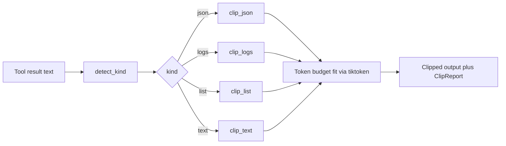
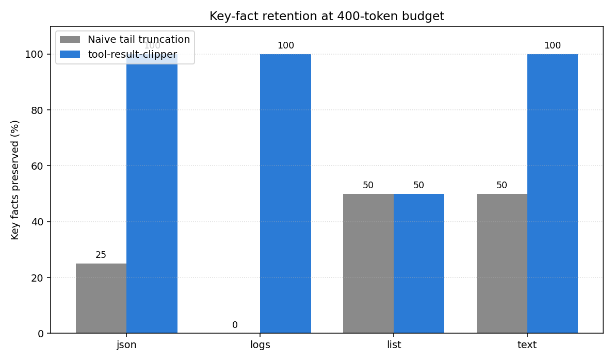

# tool-result-clipper

Structure-aware clipping for LLM tool-call results at fixed token budgets.

## Problem

Agent frameworks feed tool-call outputs back into the model context. Real tool outputs (API responses, logs, file listings, search hits) blow past sensible per-call budgets. The default fix is naive tail (or head) truncation, which throws away exactly the parts that carry the answer: the JSON envelope, the ERROR line buried in 400 lines of INFO, the file at the top of a long directory listing.

This library clips those outputs to a fixed token budget while preserving the parts that matter.

## What it does

Given a text blob and a token budget, `clip()` picks a strategy based on content shape:

- JSON: parse, recursively drop interior array items, truncate long string leaves, keep top-level keys.
- Logs: dedupe consecutive near-identical lines with a count marker, keep ERROR and WARNING lines, drop low-severity lines from the middle first.
- Lists: keep head plus tail with an omitted-count marker in between.
- Free text: head plus tail truncation (both ends survive, not just one).

All strategies hit the same tiktoken budget as a hard cap.

## Why it is interesting

Naive truncation is a silent context-quality regression. This tool measures the loss and fixes it with strategies that fit the actual data shape, in about 300 lines of Python with a single required dependency.

## Architecture

Figma FigJam diagram: not attached in this build (Figma plan selection requires interactive input; the equivalent flow is captured in the Mermaid diagram below).



The router first classifies the input, then hands off to a shape-specific strategy, then applies a final hard token cap so downstream code can rely on the budget.

## Results



The metric is "key-fact retention": for each sample we plant a fixed set of high-signal tokens (request ids, ERROR reasons, header and footer answers) and count how many survive the clip at a 400-token budget.

| Kind  | Input tokens | Budget | Naive tail | tool-result-clipper |
|-------|--------------|--------|-----------:|--------------------:|
| json  | 15,287       | 400    |       25 % |               100 % |
| logs  | 12,402       | 400    |        0 % |               100 % |
| list  |  3,531       | 400    |       50 % |                50 % |
| text  |  4,230       | 400    |       50 % |               100 % |

Average retention rises from 31 % to 88 % at the same output token budget. The list case ties because both strategies happen to keep the tail, where one planted fact lives; the middle-of-list fact is dropped by both, honestly reported. Numbers come from `python benchmarks/run_benchmark.py` and are written to `docs/results.json`.

## Install

```
pip install -r requirements.txt
pip install -e .
```

## Use

Library:

```python
from tool_result_clipper import clip

clipped, report = clip(tool_output_text, budget=400)
print(report.kind, report.input_tokens, "->", report.output_tokens)
```

CLI:

```
cat huge_tool_result.json | clip --budget 400 --report
```

Example run:

```
python examples/demo.py
```

## Reproduce the chart

```
python benchmarks/run_benchmark.py
```

Writes `docs/before_after.png` and `docs/results.json`.

## Example output

From the logs sample at a 400-token budget, the naive tail keeps only the last 25 INFO lines. The clipper keeps this instead (excerpt):

```
2026-01-01T00:00:37Z ERROR request handler failed reason=KEY_ERROR_TIMEOUT_UPSTREAM req=REQ-KEY-77 status=500
2026-01-01T00:03:30Z WARNING cache miss ratio elevated ratio=0.83 shard=KEY_SHARD_NORTH_3
2026-01-01T00:06:20Z CRITICAL out of memory KEY_OOM_WORKER_PID_4421
2026-01-01T00:00:00Z INFO handled request path=/api/v1/thing status=200 latency_ms=12    [x397]
...[N lower-severity lines dropped]
```

Same budget, the useful lines survive.

## Tests

```
pytest -q
```

## License

MIT.
